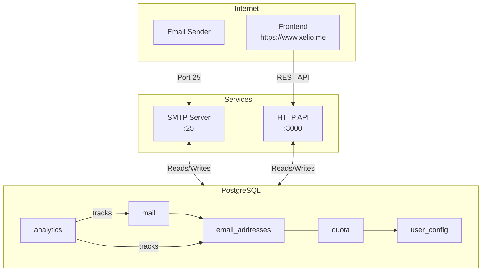

# TempMail

Temporary email service with SMTP receiving and HTTP API.

## Architecture



## Features

- SMTP server for receiving emails
- REST API for email management
- UUID-based identifiers
- Rate limiting (100 req/sec, burst 150)
- Analytics tracking
- Mailboxes expire after 24 hours; deleted or expired usernames can be reused
- Lifetime counter of successfully created addresses, including reused names

## Quick Start

Start local PostgreSQL with Docker (data persists in its own named volume):

```bash
docker compose -f docker-compose.local.yml up -d --wait
```

For a new checkout, copy `.env.example` to `.env`. For an existing checkout,
update the database settings without overwriting other configuration:

```dotenv
DB_HOST=127.0.0.1
DB_USER=tempmail
DB_PASSWORD=tempmail_local
DB_NAME=tempmail
DB_PORT=5432
DB_SSLMODE=disable
MAIL_DOMAIN=xelio.me
SMTP_PORT=1025
```

`LOCAL_POSTGRES_PORT` and `LOCAL_POSTGRES_PASSWORD` customize the Docker
database. Set matching `DB_PORT` and `DB_PASSWORD` in the application.
Changing the password after volume initialization also requires changing it
inside PostgreSQL. Hosted PostgreSQL remains supported with `DB_SSLMODE=require`.
Starting an empty local database does not import the hosted database's data.

```bash
# Build
cargo build --release

# Run services
cargo run --package http    # API on :3000
cargo run --package smtp    # SMTP on :1025 with the local settings above
```

## API Endpoints

| Method | Endpoint | Description |
|--------|----------|-------------|
| GET | `/` | Health check |
| POST | `/api/emails` | Create email address |
| GET | `/api/emails` | List all addresses |
| GET | `/api/emails/:address` | Get emails for address |
| DELETE | `/api/emails/:address` | Delete address |
| GET | `/api/emails/:address/:id` | Get single email |
| DELETE | `/api/emails/:address/:id` | Delete email |
| GET | `/api/stats` | Get usage statistics |

### Lifetime usage count

`GET /api/stats` is public and returns the standard API wrapper, including:

```json
{
  "success": true,
  "data": {
    "total_addresses_created": 693,
    "total_addresses": 12,
    "total_emails": 24,
    "total_webhooks": 0,
    "events": []
  },
  "error": null
}
```

Values above are illustrative. The client can read
`response.data.total_addresses_created` and display **"693 temporary inboxes
created"**. This counts successful creations, including reuse of the same
username; it does not count unique people. Failed or conflicting creations do
not increment it, and deletion, expiry, or service restarts do not reduce it.
The counter is updated in the same transaction as mailbox creation.

Existing installations automatically seed the count from the larger of the
existing creation analytics, username registry count, and retained mailbox
count. Historical creations missing from all three sources cannot be recovered.
Restart both HTTP and SMTP services together when deploying this change.

### Expiry and reuse

Mailbox access and SMTP delivery enforce the 24-hour deadline immediately.
Both services sweep expired records every minute. Creating an expired username
also removes its old records immediately, so reuse does not wait for a sweep.
Cleanup deletes the old messages, quota, webhook configuration, and username
reservation. A reclaimed mailbox receives a new ID and access token.

SMTP rejects unknown or expired addresses with `550` until they are reclaimed.
It accepts and stores mail for active addresses before acknowledging DATA, even
if the sender disconnects without QUIT. A transaction started for a previous
owner cannot deliver mail into the replacement mailbox. Future mail addressed
to a reclaimed address will reach its new owner.

### Database and SMTP lifecycle tests

The lifecycle tests require an isolated database whose name ends in `_test`.
They verify expiry, reuse, ownership isolation, concurrent claims, durable
counts, and SMTP delivery over a real TCP connection:

```bash
docker compose -f docker-compose.local.yml exec -T db createdb -U tempmail tempmail_lifecycle_test
env DB_HOST=127.0.0.1 DB_USER=tempmail DB_PASSWORD=tempmail_local \
  DB_NAME=tempmail_lifecycle_test DB_PORT=5432 DB_SSLMODE=disable \
  MAIL_DOMAIN=xelio.me cargo test --workspace -- --include-ignored
```

For checks without PostgreSQL, run `cargo test --workspace`.

## Environment Variables

| Variable | Default | Description |
|----------|---------|-------------|
| `DB_HOST` | (required) | PostgreSQL host |
| `DB_USER` | (required) | Database user |
| `DB_PASSWORD` | (required) | Database password |
| `DB_NAME` | (required) | Database name |
| `DB_PORT` | `5432` | PostgreSQL port |
| `DB_SSLMODE` | `prefer` | `disable`, `prefer`, or `require` |
| `MAIL_DOMAIN` | `xelio.me` | Email domain |
| `SMTP_PORT` | `25` | SMTP port |
| `MAX_EMAIL_SIZE_BYTES` | `2097152` | SMTP message cap; accepted range 64 KiB - 25 MiB |
| `TURNSTILE_ENABLED` | `false` | Require a Turnstile token on `POST /api/emails` |
| `TURNSTILE_SITE_KEY` | (empty) | Public widget key, also used by the frontend |
| `TURNSTILE_SECRET_KEY` | (empty) | Server-only verification secret |
| `TURNSTILE_EXPECTED_ACTION` | `create` | Required widget action; empty disables the check |
| `TURNSTILE_REQUIRED_HOSTNAMES` | `xelio.me,www.xelio.me` | Hostnames Cloudflare may report |
| `ALERT_WEBHOOK_URL` | (empty) | Slack/Discord webhook; empty disables alerting |
| `ALERT_CREATES_PER_MIN` | `60` | Alert threshold for successful creations |
| `ALERT_REJECTIONS_PER_MIN` | `120` | Alert threshold for rejected creations |
| `ALERT_MAILS_PER_MIN` | `60` | Alert threshold for inbound mail |
| `ALERT_429_PER_MIN` | `30` | Alert threshold for rate-limited requests |
| `ALERT_COOLDOWN_SECS` | `1800` | Minimum gap between repeats of one alert |
| `PANEL_URL` | `https://api.xelio.me/admin-panel` | Link included in alert messages |
| `FORENSICS_RETENTION_DAYS` | `7` | Retention for `access_events`, clamped to 1-90 |

## CORS

Allowed origins: `https://www.xelio.me`, `localhost:*`

## Request inspector (abuse triage)

Mailbox creation is unauthenticated by design, so the API can be driven directly
by scripts even when the web app shows no traffic. To make that attributable, the
HTTP service keeps a bounded in-memory log of recent requests and exposes it
behind the admin token:

| Route | Auth | Purpose |
|-------|------|---------|
| `GET /admin` | none (page only) | Inspector UI |
| `GET /api/admin/requests?limit=500&creates_only=true` | `x-admin-token` | Raw rows |
| `GET /api/admin/requests/geo?limit=500&creates_only=true` | `x-admin-token` | Rows enriched with country/city/ASN |

Each row records time, client IP, method, path, status, latency, user agent,
`Origin`, and `Referer`. `POST /api/emails` also emits one structured log line
with `ip`, `ua`, `status`, and `ms`, and rate-limited requests log a `rate
limited` warning, so the Coolify log stream keeps carrying attribution data
after the in-memory buffer rotates.

Client IP is read from `X-Forwarded-For` (first entry), then `X-Real-IP`. This is
only safe because Coolify's Traefik replaces inbound `X-Forwarded-For` with the
peer address instead of trusting it; keep that behaviour if the proxy changes.

The buffer holds the newest 10,000 requests and resets on deploy. Geo lookup uses
ip-api.com in batches of 100 unique IPs (max 500 per request) with a 24-hour
cache. Disable it by setting `GEO_API_URL=` (empty) if you do not want IPs sent
to a third party.

### Admin panel

`GET /admin-panel` serves a server-rendered operations panel for the same
in-memory data. It is separate from the `/admin` inspector and needs no
JavaScript, CDN assets, or admin token.

Set `ADMIN_PANEL_PASSWORD` to enable it. If the variable is unset or empty, every
panel route returns `503`; there is no default password. Sign in at
`POST /admin-panel/login` (form field `password`), and sign out with the POST
form in the panel header (`POST /admin-panel/logout`). Successful login sets
`xelio_panel`, an `HttpOnly; Secure; SameSite=Strict` cookie with a 12-hour
session; sessions live in process memory and reset on deploy. Failed logins are
counted per client IP, and 8 failures in 10 minutes return `429` until the
window expires. The passed password is never logged.

The dashboard supports `?q=`, `?country=` (exact country code), `?creates_only=`,
`?limit=` (default 200, max 1000), and `?refresh=1` for a 30-second meta refresh.


### Panel export and controls

| Route | Auth | Purpose |
|-------|------|---------|
| `GET /admin-panel/export.csv?q=&country=&creates_only=` | session cookie | Current filtered view as CSV |
| `POST /admin-panel/alert-test` | session cookie | Deliver a synthetic alert to confirm the webhook |

The CSV export is not capped at the dashboard page size: it writes every row in
the in-memory buffer that matches the filters, so it can be handed to a host or
an abuse desk as-is. It is served with `Cache-Control: no-store`.

## Abuse gate (Cloudflare Turnstile)

IP blocking cannot separate scripts from users here: the observed traffic came
from consumer ISPs across four countries with a spoofed desktop Chrome user
agent and no `Origin` header. A challenge is the only gate that survives that,
so `POST /api/emails` can require a Turnstile token.

Enable it in this order:

1. Create a Turnstile widget for `xelio.me` and `www.xelio.me` in the Cloudflare
   dashboard. Put the site key in `TURNSTILE_SITE_KEY` and the secret in
   `TURNSTILE_SECRET_KEY`.
2. Deploy the backend with `TURNSTILE_ENABLED=false`. Nothing changes yet.
3. Ship the widget on the site (see below) with `action: "create"`.
4. Set `TURNSTILE_ENABLED=true` and redeploy.

Rolling back is the same single variable. Verification fails **closed**: if
Cloudflare is unreachable the endpoint returns `503` instead of creating an
unverified mailbox, and the flag is the kill switch.

Reads, stats, and the panel are never challenged, so checking mail stays free of
friction.

### Frontend widget

The site renders explicitly so the token can be read and refreshed:

```html
<div class="cf-turnstile" data-sitekey="TURNSTILE_SITE_KEY" data-action="create"></div>
<script src="https://challenges.cloudflare.com/turnstile/v0/api.js" async defer></script>
```

Send the token with the create request and refresh it when it expires:

```js
const token = document.querySelector('[name="cf-turnstile-response"]').value;

const response = await fetch("https://api.xelio.me/api/emails", {
  method: "POST",
  headers: { "Content-Type": "application/json" },
  body: JSON.stringify({ username, turnstile_token: token }),
});

if (response.status === 403) {
  // Token missing/expired/rejected: reset the widget and let the user retry.
  window.turnstile.reset();
}
```

`cf-turnstile-response` also works as a header if the body shape must stay
unchanged.

### Error codes

| Status | `code` | Meaning |
|--------|--------|---------|
| `403` | `turnstile_missing` | No token was sent |
| `403` | `turnstile_failed` | Cloudflare rejected the token, hostname, or action |
| `503` | `turnstile_unavailable` | Verification could not be completed; retry later |

## Alerting

`ALERT_WEBHOOK_URL` turns on a once-a-minute evaluation of the last minute of
traffic. Four signals are checked: creations, rejected creations, inbound mail
(as an analytics delta), and `429`s. Each alert fires at most once per
`ALERT_COOLDOWN_SECS` and includes the top creating IPs and a panel link.

The payload contains both `text` and `content`, so a Slack or Discord webhook
works unchanged. With the variable unset the task is not spawned at all and the
API behaves exactly as before. Confirm the wiring with
`POST /admin-panel/alert-test` while signed in.

## Abuse contact

`GET /abuse` is a plain HTML page for reporters, and
`GET /.well-known/security.txt` publishes the same contact machine-readably.
Both are public on purpose. Keep `abuse@xelio.me` forwarding to a real inbox at
your mail provider: a mailbox here expires after 24 hours and will not receive
the report.

## Durable forensics

The admin panel reads an in-memory buffer, which resets on deploy. Creation
attempts are also written to the `access_events` table (`at`, `ip`,
`user_agent`, `origin`, `path`, `status`) so attribution survives restarts. The
minute scheduler deletes rows older than `FORENSICS_RETENTION_DAYS`.

This table holds IP addresses, which are personal data. Keep the retention short,
document the purpose, and treat exports accordingly. Writes are best effort: a
failed insert is logged and never fails the request.
