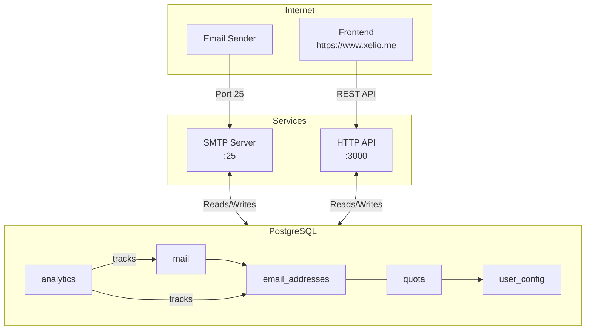

# TempMail

Temporary email service with SMTP receiving and HTTP API.

## Architecture



## Features

- SMTP server for receiving emails
- REST API for email management
- UUID-based identifiers
- Rate limiting (100 req/sec, burst 150)
- Analytics tracking
- Mailboxes expire after 24 hours; deleted or expired usernames can be reused
- Lifetime counter of successfully created addresses, including reused names

## Quick Start

Start local PostgreSQL with Docker (data persists in its own named volume):

```bash
docker compose -f docker-compose.local.yml up -d --wait
```

For a new checkout, copy `.env.example` to `.env`. For an existing checkout,
update the database settings without overwriting other configuration:

```dotenv
DB_HOST=127.0.0.1
DB_USER=tempmail
DB_PASSWORD=tempmail_local
DB_NAME=tempmail
DB_PORT=5432
DB_SSLMODE=disable
MAIL_DOMAIN=xelio.me
SMTP_PORT=1025
```

`LOCAL_POSTGRES_PORT` and `LOCAL_POSTGRES_PASSWORD` customize the Docker
database. Set matching `DB_PORT` and `DB_PASSWORD` in the application.
Changing the password after volume initialization also requires changing it
inside PostgreSQL. Hosted PostgreSQL remains supported with `DB_SSLMODE=require`.
Starting an empty local database does not import the hosted database's data.

```bash
# Build
cargo build --release

# Run services
cargo run --package http    # API on :3000
cargo run --package smtp    # SMTP on :1025 with the local settings above
```

## API Endpoints

| Method | Endpoint | Description |
|--------|----------|-------------|
| GET | `/` | Health check |
| POST | `/api/emails` | Create email address |
| GET | `/api/emails` | List all addresses |
| GET | `/api/emails/:address` | Get emails for address |
| DELETE | `/api/emails/:address` | Delete address |
| GET | `/api/emails/:address/:id` | Get single email |
| DELETE | `/api/emails/:address/:id` | Delete email |
| GET | `/api/stats` | Get usage statistics |

### Lifetime usage count

`GET /api/stats` is public and returns the standard API wrapper, including:

```json
{
  "success": true,
  "data": {
    "total_addresses_created": 693,
    "total_addresses": 12,
    "total_emails": 24,
    "total_webhooks": 0,
    "events": []
  },
  "error": null
}
```

Values above are illustrative. The client can read
`response.data.total_addresses_created` and display **"693 temporary inboxes
created"**. This counts successful creations, including reuse of the same
username; it does not count unique people. Failed or conflicting creations do
not increment it, and deletion, expiry, or service restarts do not reduce it.
The counter is updated in the same transaction as mailbox creation.

Existing installations automatically seed the count from the larger of the
existing creation analytics, username registry count, and retained mailbox
count. Historical creations missing from all three sources cannot be recovered.
Restart both HTTP and SMTP services together when deploying this change.

### Expiry and reuse

Mailbox access and SMTP delivery enforce the 24-hour deadline immediately.
Both services sweep expired records every minute. Creating an expired username
also removes its old records immediately, so reuse does not wait for a sweep.
Cleanup deletes the old messages, quota, webhook configuration, and username
reservation. A reclaimed mailbox receives a new ID and access token.

SMTP rejects unknown or expired addresses with `550` until they are reclaimed.
It accepts and stores mail for active addresses before acknowledging DATA, even
if the sender disconnects without QUIT. A transaction started for a previous
owner cannot deliver mail into the replacement mailbox. Future mail addressed
to a reclaimed address will reach its new owner.

### Database and SMTP lifecycle tests

The lifecycle tests require an isolated database whose name ends in `_test`.
They verify expiry, reuse, ownership isolation, concurrent claims, durable
counts, and SMTP delivery over a real TCP connection:

```bash
docker compose -f docker-compose.local.yml exec -T db createdb -U tempmail tempmail_lifecycle_test
env DB_HOST=127.0.0.1 DB_USER=tempmail DB_PASSWORD=tempmail_local \
  DB_NAME=tempmail_lifecycle_test DB_PORT=5432 DB_SSLMODE=disable \
  MAIL_DOMAIN=xelio.me cargo test --workspace -- --include-ignored
```

For checks without PostgreSQL, run `cargo test --workspace`.

## Environment Variables

| Variable | Default | Description |
|----------|---------|-------------|
| `DB_HOST` | (required) | PostgreSQL host |
| `DB_USER` | (required) | Database user |
| `DB_PASSWORD` | (required) | Database password |
| `DB_NAME` | (required) | Database name |
| `DB_PORT` | `5432` | PostgreSQL port |
| `DB_SSLMODE` | `prefer` | `disable`, `prefer`, or `require` |
| `MAIL_DOMAIN` | `xelio.me` | Email domain |
| `SMTP_PORT` | `25` | SMTP port |

## CORS

Allowed origins: `https://www.xelio.me`, `localhost:*`
